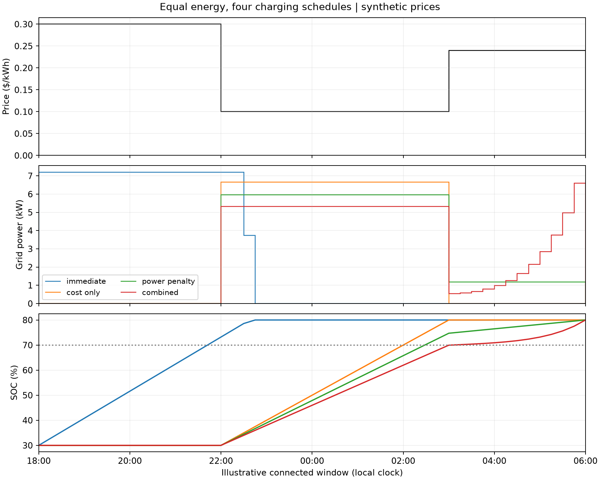

# Battery-Aware Nonlinear Optimization of EV Charging Schedules

CSE 543T working prototype, November 14, 2026. Presentation **November 24**; final report/software **December 13 at 11:59 p.m.**

Implemented: one vehicle, four equal-energy schedules, convex optimization with CVXPY/CLARABEL, a source-verified **calendar-only** capacity-loss evaluator, five original ACN records with retrospective pilot simulations, saved results and a 12-pair weight sweep. The source verification is from Naumann's full author dissertation and official code; the journal article full text was not obtained. No measured health or lifetime improvement is claimed.

## Reproduce

Python 3.12 was used. From this repository:

```sh
python3 -m venv .venv
.venv/bin/python -m pip install -r requirements.txt
.venv/bin/python -m unittest discover -s tests -v
.venv/bin/python src/run_example.py
.venv/bin/python src/inspect_data.py
```

For the preconfigured desktop runtime used during development, the existing `.venv` works directly. To create one with that interpreter, use `/Users/tongyangwang/.cache/codex-runtimes/codex-primary-runtime/dependencies/python/bin/python3 -m venv .venv` instead of the first command. That host-specific path is not required on another computer. The development environment used bundled NumPy and common dependencies via `--system-site-packages`; `requirements.txt` supports an ordinary clean environment. Exact installed versions are saved in `results/environment-lock.txt`; that full lock includes unrelated bundled packages and is for auditing, not the installation command.

Execution needs no network after dependencies are installed. Frozen API data is included. First plotting run can take time to build the font cache. Metrics are deterministic to solver tolerance; runtime values depend on the machine. The scripts overwrite generated outputs, not raw source data. A nonoptimal solve or failed material feasibility assertion raises an error; no silent repair is applied.

## Main results

| Strategy | Electricity cost | Power proxy | High-SOC proxy | Calendar loss increment (ppm) |
|---|---:|---:|---:|---:|
| Immediate | $9.0933 | 0.380601 | 0.072205 | 34.3401 |
| Cost-only | $3.3333 | 0.357225 | 0.032118 | 30.7634 |
| Power penalty | $3.8263 | 0.292384 | 0.017258 | 30.0301 |
| Combined penalties | $4.2707 | 0.269200 | 0.005289 | 29.2660 |

Every schedule delivers 33.333333 grid kWh / 30 battery kWh and reaches 80% from 30% SOC. Synthetic prices and an assumed 60-kWh battery are used. Combined penalties cost about $0.94 extra versus cost-only. Lower scores here do not establish a general improvement; combined has a higher peak than power-only. Calendar values depend on an assumed 365-day prehistory, constant 25 C and a specific LFP-cell law applied to a pack.



## Files to review

- [Model specification and source audit](docs/model_specification.md): equations, units, tested conditions, history, mapping, optimization and limitations.
- [Data-access assessment](docs/data_access_assessment.md): successful public demo access, raw versus assumed fields, timing anomaly and legitimate fallback.
- [Updated three-member plan](EV_Charging_Initial_Project_Plan.md): evidence-based scope and preserved deadlines.
- [Machine-readable comparisons](results/comparison.json), [CSV](results/comparison.csv), [table](results/comparison.md), [saved power/SOC schedules](results/schedules.csv), [weight sweep](results/weight_sweep.json).
- [Five-session audit](data/sample_sessions.csv), [raw API response](data/acn_sessions_raw.json), [20 real-session pilot outputs](results/real_session_pilot.json).
- [Executed verification log](results/verification.txt), [environment](results/environment.json).

Seven verification tests cover equal energy and bounds, solver feasibility, analytic flat-price uniform charging, the known cheap-slot optimum, invalid/infeasible inputs, the calendar closed form and unit conversion, history continuity, timestep invariance and idle exposure. They verify the software against its mathematical specification, not against new physical aging measurements. The scripts also assert feasibility on their runs.

The PDF handout was read and extracted to `docs/course_requirements_extracted.txt`; the supplied provisional plan is preserved under `docs/initial_plan_supplied.md`. Both requested background studies were absent. Document contents were treated as project materials; the pasted user request controlled scope and deadlines.
